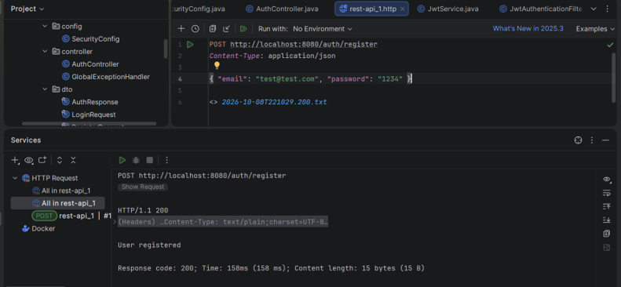
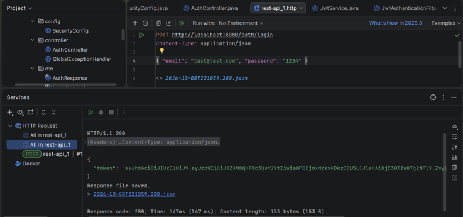
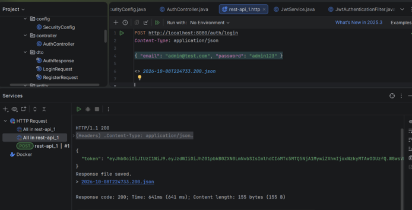

# TP 2 : Authentification avec JWT et Spring Security

**Auteur :** Hafssa Miftah Idrissi — 2026/2027

## 📑 Table des matières

1. [Objectif du TP](#1-objectif-du-tp)
2. [Outils utilisés](#2-outils-utilisés)
3. [JWT](#3-jwt)
4. [Création du projet et structure des packages](#4-création-du-projet-et-structure-des-packages)
5. [Description des classes](#5-description-des-classes)
6. [Ordre de fonctionnement de l'authentification JWT](#6-ordre-de-fonctionnement-de-lauthentification-jwt)
7. [Tests et résultats](#7-tests-et-résultats)
8. [Conclusion](#8-conclusion)

---

## 1. Objectif du TP

Le but de ce TP est de comprendre et de mettre en place l'authentification avec **JWT (JSON Web Token)** dans une application **Spring Boot** sécurisée avec **Spring Security**.

À la fin du TP, l'application doit pouvoir :

- Créer un compte utilisateur (`register`)
- Authentifier un utilisateur avec son email et son mot de passe (`login`)
- Générer un token JWT après un login réussi
- Protéger les autres URL : elles ne sont accessibles qu'avec un token valide

## 2. Outils utilisés

- Java 21
- Spring Boot 4.1.1
- Spring Security
- Spring Data JPA
- Base de données H2 (en mémoire)
- Bibliothèque JJWT (création et vérification des tokens)
- Lombok
- IntelliJ IDEA
- Client HTTP pour les tests (IntelliJ HTTP Client)

**Fichier `application.properties` :**

```properties
spring.application.name=sec_lab1
server.port=8080

spring.datasource.url=jdbc:h2:mem:securitydb
spring.datasource.driver-class-name=org.h2.Driver
spring.datasource.username=sa
spring.datasource.password=

spring.jpa.hibernate.ddl-auto=update
spring.jpa.show-sql=true

spring.h2.console.enabled=true
spring.h2.console.path=/h2-console

jwt.secret=<votre_clé_secrète_en_base64>
jwt.expiration=604800000

logging.level.org.springframework.security=DEBUG
```

> ⚠️ Ne publiez jamais votre vraie clé secrète JWT sur GitHub : utilisez une variable d'environnement ou un fichier ignoré par Git.

## 3. JWT

JWT est un jeton (token) qui prouve l'identité d'un utilisateur. Il est composé de 3 parties séparées par des points :

- **Header** : le type de token et l'algorithme de signature.
- **Payload** : les informations (l'email de l'utilisateur, la date de création, la date d'expiration).
- **Signature** : elle garantit que le token n'a pas été modifié. Elle est calculée avec une clé secrète que seul le serveur connaît.

**Avantage :** le serveur ne garde pas de session. Il est *stateless* : chaque requête contient son token, et le serveur le vérifie.

## 4. Création du projet et structure des packages

Un projet Spring Boot nommé `sec_lab1` a été créé avec le package de base `net.hmi.sec_lab1`. Le code est organisé en packages, chacun ayant un rôle précis :

```
net.hmi.sec_lab1
├── config
│   └── SecurityConfig
├── controller
│   ├── AuthController
│   └── TestController
├── dto
│   ├── AuthResponse
│   ├── LoginRequest
│   └── RegisterRequest
├── entity
│   └── AppUser
├── repository
│   └── AppUserRepository
├── security
│   └── JwtAuthenticationFilter
├── service
│   ├── CustomUserDetailsService
│   └── JwtService
└── SecLab1Application
```

| Package | Rôle |
|---|---|
| `config` | Configuration de la sécurité (`SecurityConfig`) |
| `controller` | URL de l'API (`AuthController` pour register et login, `TestController` pour tester) |
| `dto` | Objets qui transportent les données entre le client et le serveur |
| `entity` | Classe qui représente la table en base de données (`AppUser`) |
| `repository` | Accès à la base de données (`AppUserRepository`) |
| `security` | Filtre qui vérifie le token à chaque requête (`JwtAuthenticationFilter`) |
| `service` | Logique métier (`CustomUserDetailsService`, `JwtService`) |
| `SecLab1Application` | Classe principale : démarre l'application et crée deux utilisateurs (admin et user) |

## 5. Description des classes

### 5.1 L'entité `AppUser` (package `entity`)

Cette classe représente la table `users` dans la base H2. Elle contient : `id` (généré automatiquement), `email` (unique), `password` (mot de passe chiffré) et `role` (`USER` ou `ADMIN`).

```java
@Entity
@Table(name = "users")
@Data @AllArgsConstructor @NoArgsConstructor
public class AppUser {
    @Id @GeneratedValue(strategy = GenerationType.IDENTITY)
    private Long id;
    @Column(unique = true, nullable = false)
    private String email;
    private String password;
    @Column(nullable = false)
    private String role = "USER";
}
```

### 5.2 Le repository `AppUserRepository` (package `repository`)

Cette interface hérite de `JpaRepository`. Elle permet de sauvegarder et de chercher des utilisateurs sans écrire de SQL. La méthode `findByEmail` permet de chercher un utilisateur par son email.

```java
public interface AppUserRepository extends JpaRepository<AppUser, Long> {
    Optional<AppUser> findByEmail(String email);
    boolean existsByEmail(String email);
}
```

### 5.3 Les DTO (package `dto`)

- `RegisterRequest` : contient l'email et le mot de passe envoyés pour créer un compte.
- `LoginRequest` : contient l'email et le mot de passe envoyés pour se connecter.
- `AuthResponse` : contient le token renvoyé au client après le login.

```java
public record RegisterRequest(String email, String password) {}
public record LoginRequest(String email, String password) {}
public record AuthResponse(String token) {}
```

### 5.4 `CustomUserDetailsService` (package `service`)

Spring Security a besoin de savoir comment trouver un utilisateur. Cette classe implémente `UserDetailsService` : elle cherche l'utilisateur dans la base avec son email, puis le transforme en objet `UserDetails` (email, mot de passe, rôle). Elle contient aussi le bean `PasswordEncoder` (BCrypt) qui sert à chiffrer et comparer les mots de passe.

```java
@Service
public class CustomUserDetailsService implements UserDetailsService {
    private final AppUserRepository userRepository;

    public CustomUserDetailsService(AppUserRepository userRepository) {
        this.userRepository = userRepository;
    }

    @Override
    public UserDetails loadUserByUsername(String username) throws UsernameNotFoundException {
        AppUser user = userRepository.findByEmail(username)
                .orElseThrow(() -> new UsernameNotFoundException("User not found"));
        return User.builder()
                .username(user.getEmail())
                .password(user.getPassword())
                .roles(user.getRole())
                .build();
    }

    @Bean
    public PasswordEncoder passwordEncoder() {
        return new BCryptPasswordEncoder();
    }
}
```

### 5.5 `JwtService` (package `service`)

C'est la classe principale pour le token. Elle fournit :

- `generateToken` : crée le token avec l'email, la date de création et la date d'expiration, puis le signe avec la clé secrète.
- `extractUsername` : lit l'email contenu dans le token.
- `isTokenValid` : vérifie que le token est bien signé, que l'email correspond à l'utilisateur, et que le token n'est pas expiré.

```java
@Service
public class JwtService {

    @Value("${jwt.secret}")
    private String jwtSecret;

    @Value("${jwt.expiration}")
    private long jwtExpiration;

    private SecretKey getSecretKey() {
        byte[] keyBytes = Decoders.BASE64.decode(jwtSecret);
        return Keys.hmacShaKeyFor(keyBytes);
    }

    public String generateToken(UserDetails userDetails) {
        return Jwts.builder()
                .subject(userDetails.getUsername())
                .issuedAt(new Date())
                .expiration(new Date(System.currentTimeMillis() + jwtExpiration))
                .signWith(getSecretKey())
                .compact();
    }

    private Claims extractAllClaims(String token) {
        return Jwts.parser()
                .verifyWith(getSecretKey())
                .build()
                .parseSignedClaims(token)
                .getPayload();
    }

    public String extractUsername(String token) {
        return extractAllClaims(token).getSubject();
    }

    private boolean isTokenExpired(String token) {
        return extractAllClaims(token).getExpiration().before(new Date());
    }

    public boolean isTokenValid(String token, UserDetails userDetails) {
        final String username = extractUsername(token);
        return username.equals(userDetails.getUsername()) && !isTokenExpired(token);
    }
}
```

### 5.6 `JwtAuthenticationFilter` (package `security`)

Ce filtre s'exécute à chaque requête. Il :

1. lit l'en-tête `Authorization` et vérifie qu'il commence par `Bearer `,
2. extrait le token et l'email,
3. charge l'utilisateur depuis la base,
4. valide le token,
5. si tout est bon, déclare l'utilisateur comme authentifié dans Spring Security (`SecurityContext`).

Si le token est absent ou invalide, la requête continue sans authentification et sera refusée sur les URL protégées.

```java
@Component
public class JwtAuthenticationFilter extends OncePerRequestFilter {

    private final JwtService jwtService;
    private final CustomUserDetailsService userDetailsService;

    public JwtAuthenticationFilter(JwtService jwtService,
                                   CustomUserDetailsService userDetailsService) {
        this.jwtService = jwtService;
        this.userDetailsService = userDetailsService;
    }

    @Override
    protected void doFilterInternal(HttpServletRequest request,
                                    HttpServletResponse response,
                                    FilterChain filterChain)
            throws ServletException, IOException {

        final String authHeader = request.getHeader("Authorization");

        // Pas d'en-tête Authorization ou pas de token Bearer
        if (authHeader == null || !authHeader.startsWith("Bearer ")) {
            filterChain.doFilter(request, response);
            return;
        }

        // Extraction du JWT
        final String jwt = authHeader.substring(7);

        try {
            final String username = jwtService.extractUsername(jwt);

            if (username != null &&
                    SecurityContextHolder.getContext().getAuthentication() == null) {

                UserDetails userDetails = userDetailsService.loadUserByUsername(username);

                if (jwtService.isTokenValid(jwt, userDetails)) {
                    UsernamePasswordAuthenticationToken authentication =
                            new UsernamePasswordAuthenticationToken(
                                    userDetails, null, userDetails.getAuthorities());

                    authentication.setDetails(
                            new WebAuthenticationDetailsSource().buildDetails(request));

                    SecurityContextHolder.getContext().setAuthentication(authentication);
                }
            }
        } catch (Exception e) {
            // JWT invalide ou expiré : la requête continue sans authentification
        }

        filterChain.doFilter(request, response);
    }
}
```

### 5.7 `SecurityConfig` (package `config`)

Cette classe configure la sécurité :

- CSRF désactivé (on utilise des tokens et pas de sessions)
- Mode `STATELESS` (aucune session côté serveur)
- `/auth/**` est public (register et login)
- `/h2-console/**` est public (pour consulter la base)
- Toutes les autres URL demandent une authentification
- `JwtAuthenticationFilter` est placé avant le filtre standard de Spring
- Un bean `AuthenticationManager` est exposé pour vérifier email et mot de passe au login

```java
@Configuration
public class SecurityConfig {

    private final JwtAuthenticationFilter jwtAuthenticationFilter;

    public SecurityConfig(JwtAuthenticationFilter jwtAuthenticationFilter) {
        this.jwtAuthenticationFilter = jwtAuthenticationFilter;
    }

    @Bean
    public SecurityFilterChain securityFilterChain(HttpSecurity http) throws Exception {
        http
            .csrf(csrf -> csrf.disable())
            .sessionManagement(session ->
                    session.sessionCreationPolicy(SessionCreationPolicy.STATELESS))
            .exceptionHandling(ex ->
                    ex.authenticationEntryPoint(
                            new HttpStatusEntryPoint(HttpStatus.UNAUTHORIZED)))
            .authorizeHttpRequests(auth -> auth
                    .requestMatchers("/auth/**").permitAll()
                    .requestMatchers("/error").permitAll()
                    .requestMatchers("/h2-console/**").permitAll()
                    .anyRequest().authenticated()
            )
            .addFilterBefore(jwtAuthenticationFilter,
                    UsernamePasswordAuthenticationFilter.class)
            .headers(headers -> headers.frameOptions(frame -> frame.disable()));

        return http.build();
    }

    @Bean
    public AuthenticationManager authenticationManager(
            AuthenticationConfiguration config) throws Exception {
        return config.getAuthenticationManager();
    }
}
```

### 5.8 `AuthController` (package `controller`)

Il contient deux URL :

- `POST /auth/register` : crée un utilisateur avec le mot de passe chiffré et le rôle `USER`.
- `POST /auth/login` : vérifie l'email et le mot de passe avec l'`AuthenticationManager`, puis génère et renvoie le token.

```java
@RestController
@RequestMapping("/auth")
public class AuthController {

    private final AuthenticationManager authenticationManager;
    private final JwtService jwtService;
    private final AppUserRepository userRepository;
    private final PasswordEncoder passwordEncoder;

    public AuthController(AuthenticationManager authenticationManager,
                          JwtService jwtService,
                          AppUserRepository userRepository,
                          PasswordEncoder passwordEncoder) {
        this.authenticationManager = authenticationManager;
        this.jwtService = jwtService;
        this.userRepository = userRepository;
        this.passwordEncoder = passwordEncoder;
    }

    @PostMapping("/register")
    public ResponseEntity<String> register(@RequestBody RegisterRequest request) {
        if (userRepository.findByEmail(request.email()).isPresent()) {
            return ResponseEntity.badRequest().body("Email already used");
        }

        AppUser user = new AppUser();
        user.setEmail(request.email());
        user.setPassword(passwordEncoder.encode(request.password()));
        user.setRole("USER");
        userRepository.save(user);

        return ResponseEntity.ok("User registered");
    }

    @PostMapping("/login")
    public ResponseEntity<AuthResponse> login(@RequestBody LoginRequest request) {
        Authentication authentication = authenticationManager.authenticate(
                new UsernamePasswordAuthenticationToken(
                        request.email(),
                        request.password()
                )
        );

        UserDetails userDetails = (UserDetails) authentication.getPrincipal();
        String token = jwtService.generateToken(userDetails);

        return ResponseEntity.ok(new AuthResponse(token));
    }
}
```

### 5.9 `SecLab1Application` (classe principale)

C'est la classe de démarrage. Elle crée au lancement deux utilisateurs de test : `admin@test.com` (rôle `ADMIN`) et `user@test.com` (rôle `USER`), avec leurs mots de passe chiffrés.

```java
@SpringBootApplication
public class SecLab1Application {

    public static void main(String[] args) {
        SpringApplication.run(SecLab1Application.class, args);
    }

    @Bean
    CommandLineRunner initDatabase(AppUserRepository repo, PasswordEncoder encoder) {
        return args -> {
            if (repo.findByEmail("admin@test.com").isEmpty()) {
                AppUser admin = new AppUser();
                admin.setEmail("admin@test.com");
                admin.setPassword(encoder.encode("admin123"));
                admin.setRole("ADMIN");
                repo.save(admin);
            }

            if (repo.findByEmail("user@test.com").isEmpty()) {
                AppUser user = new AppUser();
                user.setEmail("user@test.com");
                user.setPassword(encoder.encode("user123"));
                user.setRole("USER");
                repo.save(user);
            }
        };
    }
}
```

## 6. Ordre de fonctionnement de l'authentification JWT

### Phase 1 : Login et génération du token

1. Le client envoie `POST /auth/login` avec son email et son mot de passe.
2. `SecurityConfig` laisse passer la requête car `/auth/**` est public.
3. `AuthController` reçoit la requête et appelle l'`AuthenticationManager`.
4. L'`AuthenticationManager` appelle `CustomUserDetailsService`, qui cherche l'utilisateur dans la base grâce à `AppUserRepository`.
5. Spring compare le mot de passe envoyé avec le mot de passe chiffré (BCrypt).
6. Si c'est correct, `AuthController` demande à `JwtService` de générer le token.
7. Le token est renvoyé au client dans `AuthResponse`.
8. Si c'est incorrect, une erreur **401** est renvoyée.

### Phase 2 : Accès à une URL protégée avec le token

1. Le client envoie par exemple `GET /hello` avec l'en-tête : `Authorization: Bearer <token>`.
2. `JwtAuthenticationFilter` intercepte la requête avant le contrôleur.
3. Le filtre extrait le token et demande à `JwtService` de lire l'email.
4. Le filtre charge l'utilisateur avec `CustomUserDetailsService`.
5. Le filtre vérifie la validité du token (signature, email, expiration).
6. Si le token est valide, l'utilisateur est enregistré comme authentifié dans le `SecurityContext`.
7. `SecurityConfig` autorise la requête et le contrôleur répond.
8. Si le token est absent ou invalide, la réponse est **401**.

## 7. Tests et résultats

### Test 1 : Création d'un compte (register)

**Requête :** `POST http://localhost:8080/auth/register`

```json
{ "email": "test@test.com", "password": "1234" }
```
 <br>
**Résultat attendu :** `200 OK`, message `User registered`.

### Test 2 : Connexion avec un compte valide (login)

**Requête :** `POST http://localhost:8080/auth/login`

```json
{ "email": "test@test.com", "password": "1234" }
```

**Résultat attendu :** `200 OK`, avec un token JWT dans la réponse.

```json
{ "token": "eyJhbGciOiJIUzI1NiJ9..." }
```
 <br>

### Test 3 : Connexion avec l'utilisateur admin créé au démarrage

**Requête :** `POST http://localhost:8080/auth/login`

```json
{ "email": "admin@test.com", "password": "admin123" }
```

**Résultat attendu :** `200 OK`, avec un token JWT.
 <br>
## 8. Conclusion

Dans ce TP, nous avons créé une application Spring Boot qui utilise Spring Security et JWT pour l'authentification. Nous avons compris le rôle de chaque classe et l'ordre des étapes : login, vérification des identifiants, génération du token, puis vérification du token à chaque requête avec un filtre.

Cette méthode est adaptée aux systèmes distribués, car le serveur ne garde pas de session : le token contient les informations nécessaires et chaque service peut le vérifier avec la clé secrète.